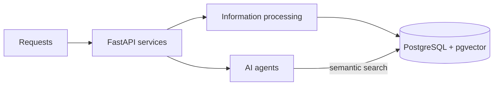

import Flow from '../../../components/mdx/Flow.astro';

## Problem

The AI agents of a C-Pocket product needed to retrieve relevant information semantically, not just by exact text matches.

## Solution

A multi-tenant backend: Python services that process information, store it with vector representations and retrieve it through semantic search for the agents.

## Functional flow

<Flow lang="en" title="From information to the agent" steps={[{"title": "Request", "actor": "Product", "text": "The product sends the request to the backend services."}, {"title": "Processing", "actor": "Backend", "text": "The information is processed and prepared for storage."}, {"title": "Vector storage", "actor": "PostgreSQL + pgvector", "text": "It is stored in PostgreSQL with pgvector so it can be searched by meaning."}, {"title": "Semantic search", "actor": "AI agent", "text": "The agent retrieves the most relevant information to answer."}]} />

## Conceptual architecture

## My contribution

I took part in backend development with **Python and FastAPI**: services for AI agents, information processing and semantic search. A team was developing the product.

## Stack

Python and FastAPI · PostgreSQL and pgvector · Redis.

## Technical challenges

- Retrieving information by meaning so agents answer with relevant context.

## Verifiable results

- **Status: development halted.** The project stopped during development; it is not presented as a finished product or as deployed in production.
- The multi-tenant architecture and the scope described are statements I confirm: the repository was not available for review.
- No quantitative results are published.

{/* Do not add LangGraph, RAG or other capabilities without the owner's confirmation. */}
