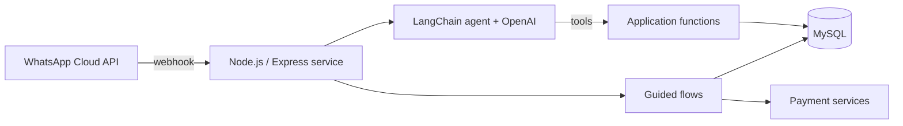

import Flow from '../../../components/mdx/Flow.astro';

## Problem

Users needed to complete operations such as signing up, buying top-ups and PINs or paying, and to ask questions, without leaving WhatsApp or installing another app.

## Solution

A conversational platform that combines guided flows for operations with AI agents that use application tools for open conversations.

## Functional flow

<Flow lang="en" title="From a message to an operation" steps={[{"title": "Incoming message", "actor": "User", "text": "The user writes on WhatsApp and the message reaches the platform through a webhook."}, {"title": "Session & context", "actor": "Platform", "text": "The user's session and the current flow state are loaded; the state is cleared when each operation ends."}, {"title": "Guided flow or agent", "actor": "Platform · AI", "text": "Operations follow guided flows with validation; open conversations are handled by a LangChain agent with OpenAI that uses application tools."}, {"title": "Operation", "actor": "Ecosystem services", "text": "Sign-ups, top-ups, PINs and payments run through the ecosystem's payment services, with a trace id per operation."}, {"title": "Reply", "actor": "User", "text": "The user gets the reply in the conversation and, when relevant, a notification with the outcome."}]} />

## Conceptual architecture

## My contribution

- Flows for **user registration, top-ups** (number validation and resend) and **PIN purchases** with provider selection.
- **OpenAI API** integration through **LangChain** agents with application tools.
- An AI WhatsApp assistant to **create and search properties** for the PropTech platform.
- **Sales reports** with permissions, query validation and aggregation rules.
- Automated tests with **Jest**, including end-to-end flow tests.

A team maintains the platform; authorship is shared.

## Stack

Node.js, Express and TypeScript · MySQL, Sequelize and Redis · WhatsApp Cloud API · OpenAI API and LangChain · Jest.

## Technical challenges

- **Stateful conversations**: sessions and per-flow data cleanup so operations never mix.
- **Traceability**: a trace id on payment requests to follow each operation across services.
- **Ambiguous input**: phone validation, resend messages and price and coordinate normalization.

## Verifiable results

- Flows implemented in the product's code, with end-to-end tests and permission tests for the reports.
