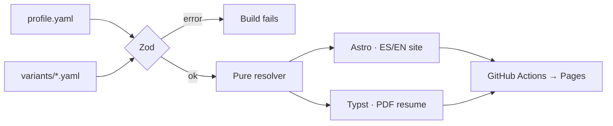

## Context

My resume is not edited in a word processor: it is **compiled**. This site and the PDF resume come from a single master profile. The code is public at [github.com/Juanprm03/developer-cv](https://github.com/Juanprm03/developer-cv) and builds on the architecture of [inehosa1/cv](https://github.com/inehosa1/cv), reused with its author's permission.

## Decisions

- **Master profile with stable ids**: experience, projects, skills and achievements are referenced by id; translations live next to each fact.
- **Variants that only select**: besides the public resume, it generates internal versions for job applications that prioritize achievements by tags and cannot add facts.
- **Context for every skill**: professional, personal or training. Tests prevent presenting training as professional experience.
- **Typst for the PDF**: real single-column text, ATS-friendly, with automatic page control.
- **Accessible motion**: CSS and IntersectionObserver animations that respect `prefers-reduced-motion` and never hide content without JavaScript.
