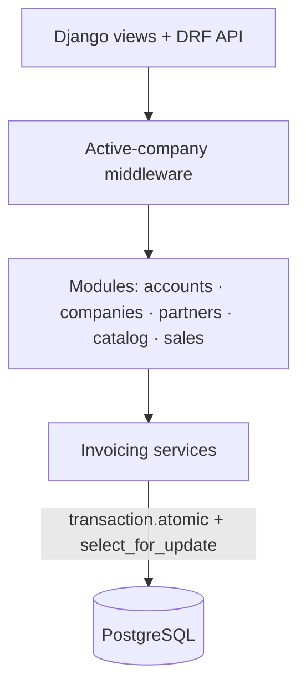

import Flow from '../../../components/mdx/Flow.astro';

## Problem

Small businesses need to invoice without numbering errors or mixed-up data, even when one person works with several companies. This ERP is my personal project, **in development** (MVP); the code is public at [github.com/Juanprm03/nexo-erp](https://github.com/Juanprm03/nexo-erp).

## Solution

A modular Django monolith with web views and a REST API that share the same service layer: every operation spanning several tables (numbering, totals, status changes) lives in one place.

## Functional flow

<Flow lang="en" title="Lifecycle of an invoice" steps={[{"title": "Active company", "actor": "User", "text": "The user picks the company they work with; a middleware sets the active company and the permissions of their role in it."}, {"title": "Draft", "actor": "Sales", "text": "The invoice is created as a draft for a customer of the same company."}, {"title": "Lines & totals", "actor": "Invoicing service", "text": "Each line is added with the invoice locked; subtotal, tax and total are recalculated with Decimal."}, {"title": "Issuing", "actor": "Invoicing service", "text": "In one transaction the invoice and the company's sequence are locked, the invoice is checked to still be a draft with lines, and the next number is assigned."}, {"title": "Voiding", "actor": "Invoicing service", "text": "Only an issued invoice can be voided; invalid status transitions are rejected."}]} />

## Conceptual architecture

## My contribution

Personal project: the design, implementation and tests are mine.

## Stack

Python, Django and Django REST Framework · PostgreSQL · Docker · pytest and pytest-django.

## Technical challenges

- **No duplicate numbers**: one sequence row per company locked with `select_for_update`, instead of computing max + 1; different companies never contend.
- **Concurrent issuing**: the invoice itself is locked too, so two simultaneous attempts cannot both pass the draft check.
- **Data isolation**: products and customers must belong to the invoice's company.
- **A single source of rules**: views, templates and the API call the same services, with no implicit signals.

## Verifiable results

- Automated tests for models, services, calculations, API, permissions, data isolation and concurrency.
- Treasury, cross-cutting auditing and inventory are future work and not part of the current functionality.
