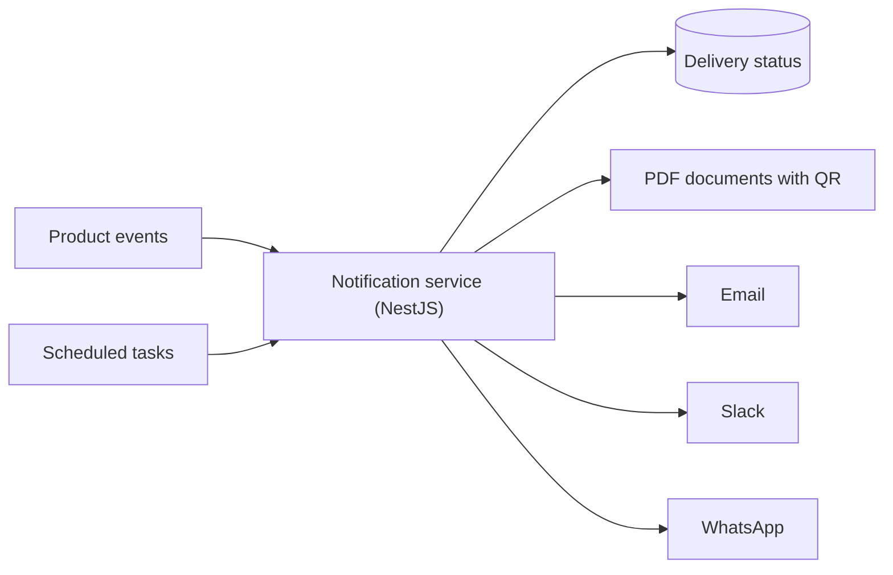

## Overview

A centralized service that receives events from the ecosystem's products and turns them into email, Slack and WhatsApp notifications, and generates documents such as PDF tickets with QR codes.

## Problem it solves

Saving each product from implementing its own delivery logic and tracking the status of every notification.

## My contribution and the team's

I was one of the main contributors to the service (**NestJS, TypeScript and Prisma**):

- Email (with retries), Slack and WhatsApp modules, including a webhook controller with configuration validation.
- Per-notification status tracking with Prisma.
- PDF tickets with QR codes and QR integrity tests.
- Scheduled reports: a daily deliveries email with a multi-sheet Excel, skipped when there is no data, plus sales alerts.
- API documentation with Swagger / OpenAPI.

## Integrations

WhatsApp Cloud API, Slack API, email and the payment and ticketing services that emit the events.

## Architecture

## Challenges & solutions

- **Reliable delivery**: retries for email and a status record for every notification.
- **Verifiable documents**: tests that check the integrity of the QR bytes in the PDF.
- **Useful reports**: an Excel with summary, breakdown and detail, and no email on days without data.

## Status

The features described are implemented.
