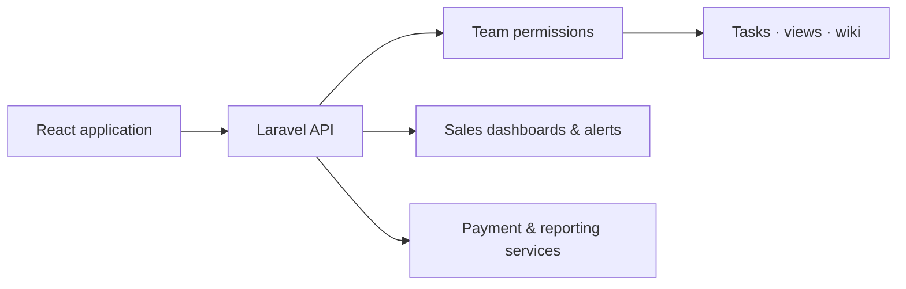

import Flow from '../../../components/mdx/Flow.astro';

## Problem

Teams needed a shared place to organize their work and follow the products' operational metrics.

## Solution

An internal application with a task board, wiki, team permissions and sales dashboards connected to the ecosystem's services.

## Functional flow

<Flow lang="en" title="From access to follow-up" steps={[{"title": "Access", "actor": "Team member", "text": "Each person signs in with their team's permissions over tasks and the wiki."}, {"title": "Organization", "actor": "Team", "text": "Tasks are managed in list or Kanban views, with properties, filters and saved views."}, {"title": "Sales follow-up", "actor": "Operations", "text": "Dashboards show sales and alerts from the ecosystem's payment and ticketing services."}, {"title": "Coordination", "actor": "Operations", "text": "Blocked dates are coordinated with the ticket admin panel without overwriting another app's changes."}]} />

## Conceptual architecture

## My contribution

- A security base for tasks and the wiki.
- A task board with properties, team permissions, saved views and a filter bar for list and Kanban.
- A sales dashboard and alerts for the ticketing ecosystem, and blocked-date coordination.
- Feature tests with **PHPUnit**.

The team built the application and its other modules.

## Stack

Laravel and PHP · React, TypeScript and Vite · PHPUnit.

## Technical challenges

- **Team permissions** that stay consistent across tasks, saved views and the wiki.
- **Concurrent changes** between applications when sharing blocked dates.

## Verifiable results

- Features implemented with feature tests for the board, permissions and saved views.
- **In development**: an integration to connect Claude with the system's tools through Model Context Protocol (MCP).

{/* REVISAR: the MCP integration is declared by the owner; its implementation was not found in the reviewed code. */}
