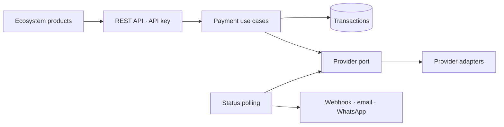

import Flow from '../../../components/mdx/Flow.astro';

## Problem

Several products needed to charge and deliver digital products without each one integrating every payment and service provider on its own, or managing each transaction's status.

## Solution

A central payment service with REST APIs: it charges by card or payment link, pays bills, delivers what was purchased and notifies the outcome to the originating product and the user.

## Functional flow

<Flow lang="en" title="Lifecycle of a transaction" steps={[{"title": "Request", "actor": "Product", "text": "An ecosystem product requests the payment from the API, authenticated with an API key and an idempotency key."}, {"title": "Registration", "actor": "Payment service", "text": "The request is validated and the transaction is recorded as pending; the idempotency key prevents processing the same charge twice."}, {"title": "Charge", "actor": "Gateway", "text": "The charge is made by card or through a payment link, via the provider's adapter."}, {"title": "Status polling", "actor": "Scheduled task", "text": "A scheduled task periodically polls pending transactions until it knows whether they were approved or rejected."}, {"title": "Delivery", "actor": "Services provider", "text": "If the payment is approved, the product is delivered with a limited number of attempts; if it fails, the transaction ends as failed."}, {"title": "Notification", "actor": "Product & user", "text": "The outcome is sent by webhook to the originating product, with bounded retries, and to the user by email or WhatsApp."}]} />

## Conceptual architecture

## My contribution

- Use cases, DTOs and endpoints for **card payments and payment links** and their status checks, with tests.
- **Idempotency keys** for card payments.
- An **RSA encryption service** for the data the provider requires, with tests.
- Use cases to **query and pay utility bills and mandatory insurance**.
- Changes to **adapters** and to provider selection while polling status.
- **Outcome webhooks** and email and WhatsApp notifications with detailed error handling.

The team built the service's foundation (companies, channels, orders, products), the request and price validation policy, and other adapters and modules.

## Stack

NestJS and TypeScript · Prisma and MySQL · scheduled tasks · Jest · Zod.

## Technical challenges

- **Retries without double charges**: idempotency with a per-company, per-key lock.
- **Multiple providers**: a common port and one adapter per provider, without coupling the use cases.
- **Charging and delivery are separate**: distinct lifecycle steps, each with its own retries and a record of every attempt.
- **Reliable webhooks**: destinations checked against an allowlist, a per-attempt timeout and increasing waits.

## Verifiable results

- Card, payment-link, status and notification flows implemented in the code, with tests for the use cases and the encryption.
- Reconciliation, fraud prevention and refunds are not documented: they are not part of the evidence reviewed.
