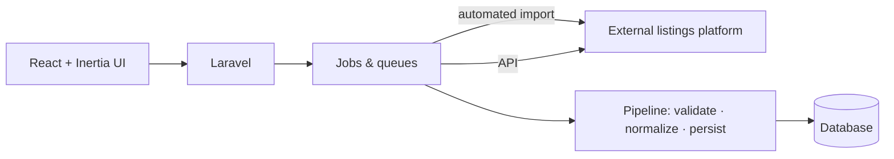

## Overview

The ecosystem's real-estate platform: property management and search, import and publication to an external listings platform, and WhatsApp automation.

## Problem it solves

Centralizing an agency's property inventory and keeping it in sync with an external listings platform without manual data entry.

## My contribution and the team's

I was one of the main contributors to the repository, with fullstack work in **Laravel, React, Inertia and TypeScript**:

- Property management, detail and search pages.
- Integration with the external platform through two separate paths: **automated import** of listings and its **API** to query, create and update listings and images.
- An import pipeline with validation, transactional persistence and deferred processing of contacts and images.
- Jobs, queues and commands for synchronization, auditing and data maintenance.

## Integrations

An external real-estate listings platform (HTML and API) and WhatsApp through the conversational platform's assistant.

## Architecture

## Challenges & solutions

- **Expiring external sessions**: an HTTP client with cookies, session restore and re-authentication on expiry, with request limits.
- **Heterogeneous data**: a parser that extracts prices, location, features, contacts, images and coordinates and validates minimum content.
- **Partial failures**: classification of recoverable and non-recoverable errors, retries with backoff and partial-error reporting on publish.

## Status

Implemented: HTML and API import, remote publishing and updates. Archiving and deleting remain local operations.
