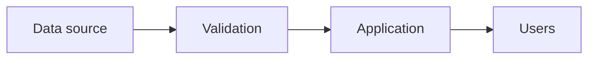

> **Placeholder.** This case study is sample content and does not describe any real project.
> It is used to check the MDX collection, Mermaid rendering and the landing-page cards.

## Context

[PLACEHOLDER] Business problem and starting point.

## Decisions

- [PLACEHOLDER] Technical decision and its rationale.

## Outcomes

- [PLACEHOLDER] Measurable, verifiable outcome.
