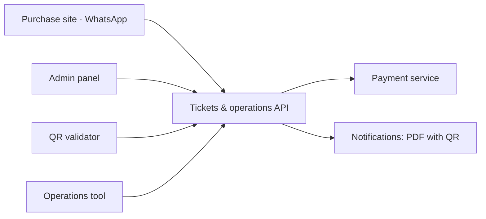

import Flow from '../../../components/mdx/Flow.astro';

## Problem

A client in the entertainment sector needed to sell digital tickets, deliver them reliably, validate them at the box office and give its teams tools to manage products, dates, users and sales. A purchase bot was not enough: the whole cycle had to be covered.

## Solution

An ecosystem of applications connected to a central tickets and operations API: a purchase site with a WhatsApp entry point, PDF tickets with QR codes, a box-office validator, an admin panel and reports with alerts.

## Functional flow

<Flow lang="en" title="From order to entrance" steps={[{"title": "Purchase", "actor": "Visitor", "text": "The visitor picks a ticket on the purchase site or reaches it from a WhatsApp entry point."}, {"title": "Payment", "actor": "Payment service", "text": "The purchase is charged through the ecosystem's payment service."}, {"title": "Delivery", "actor": "Notifications", "text": "The ticket is delivered securely as a PDF with a QR code by email or WhatsApp."}, {"title": "Validation", "actor": "Box office", "text": "At the entrance, the validator checks the signed QR code and records every action in an audit log."}, {"title": "Operations & reports", "actor": "Admin", "text": "The panel manages products, blocked dates and users, and provides sales and delivery reports with alerts."}]} />

## Conceptual architecture

## My contribution

| Component | My contribution |
|---|---|
| Tickets & operations API | I built the module: tickets, operators, products, blocked dates, reports, authentication and read model |
| Admin panel | Date calendar, passes and discounts, deliveries report, Excel-exportable dashboard, help manual and hardened login |
| QR validator | Audit log with retention, rejection of unsigned QR codes, versioned sessions and effective user offboarding |
| Purchase site | WhatsApp purchase entry point |
| Notifications & operations | PDF tickets with QR codes, daily deliveries email, alerts and sales dashboard |

The team built the foundation of the purchase site, the admin panel and the validator.

## Stack

Node.js and Express (API) · Next.js, React, TypeScript and Tailwind CSS (panel, validator and site) · MySQL · NestJS (notifications) · Vitest and Zod.

## Technical challenges

- **Long box-office shifts**: long enough sessions with versioning, so reactivating a user never revives old sessions.
- **Entrance security**: rejection of unsigned QR codes and an audit log of each tablet's actions.
- **Concurrent changes**: blocked dates shared between applications without overwriting each other's changes.
- **Uncertain outcomes**: safe handling of ticket operations with uncertain results.

## Verifiable results

- Features implemented and present in the ecosystem's code.
- Permission and sales-aggregation tests in the API, and validator tests.

Confidential project: the client, sales data, users and infrastructure are not published.
