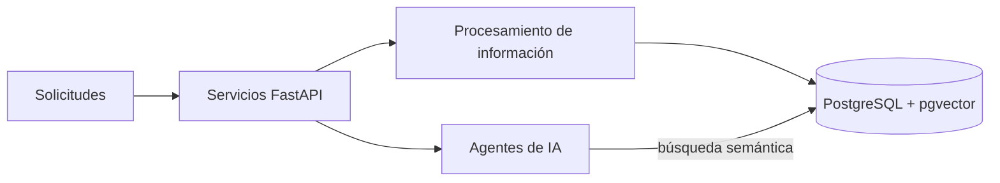

import Flow from '../../../components/mdx/Flow.astro';

## Problema

Los agentes de IA de un producto de C-Pocket necesitaban recuperar información relevante de forma semántica, no solo por coincidencia exacta de texto.

## Solución

Un backend multi-tenant: servicios en Python que procesan la información, la almacenan con representaciones vectoriales y la recuperan mediante búsqueda semántica para los agentes.

## Flujo funcional

<Flow lang="es" title="De la información al agente" steps={[{"title": "Solicitud", "actor": "Producto", "text": "El producto envía la solicitud a los servicios backend."}, {"title": "Procesamiento", "actor": "Backend", "text": "La información se procesa y se prepara para su almacenamiento."}, {"title": "Almacenamiento vectorial", "actor": "PostgreSQL + pgvector", "text": "Se guarda en PostgreSQL con pgvector para poder buscarla por significado."}, {"title": "Búsqueda semántica", "actor": "Agente de IA", "text": "El agente recupera la información más relevante para responder."}]} />

## Arquitectura conceptual

## Mi contribución

Participé en el desarrollo backend con **Python y FastAPI**: servicios para agentes de IA, procesamiento de información y búsqueda semántica. El producto lo desarrollaba un equipo.

## Stack

Python y FastAPI · PostgreSQL y pgvector · Redis.

## Retos técnicos

- Recuperar información por significado para que los agentes respondan con contexto relevante.

## Resultados verificables

- **Estado: desarrollo detenido.** El proyecto se detuvo durante su desarrollo; no se presenta como un producto terminado ni desplegado en producción.
- La arquitectura multi-tenant y el alcance descrito son afirmaciones confirmadas por mí: el repositorio no estuvo disponible para revisión.
- No se publican resultados cuantitativos.

{/* No añadir LangGraph, RAG ni otras capacidades sin confirmación del propietario. */}
