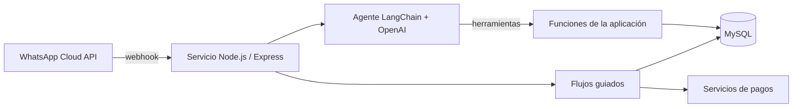

import Flow from '../../../components/mdx/Flow.astro';

## Problema

Los usuarios necesitaban completar operaciones como registrarse, comprar recargas y pines o pagar, y hacer consultas, sin salir de WhatsApp ni instalar otra aplicación.

## Solución

Una plataforma conversacional que combina flujos guiados para las operaciones y agentes de IA con herramientas de la aplicación para las conversaciones abiertas.

## Flujo funcional

<Flow lang="es" title="De un mensaje a una operación" steps={[{"title": "Mensaje entrante", "actor": "Usuario", "text": "El usuario escribe por WhatsApp y el mensaje llega a la plataforma mediante un webhook."}, {"title": "Sesión y contexto", "actor": "Plataforma", "text": "Se recupera la sesión del usuario y el estado del flujo en curso, que se limpia al terminar cada operación."}, {"title": "Flujo guiado o agente", "actor": "Plataforma · IA", "text": "Las operaciones siguen flujos guiados con validaciones; las conversaciones abiertas las atiende un agente de LangChain con OpenAI que usa herramientas de la aplicación."}, {"title": "Operación", "actor": "Servicios del ecosistema", "text": "Registros, recargas, pines y pagos se ejecutan con los servicios de pagos del ecosistema, con un identificador de traza por operación."}, {"title": "Respuesta", "actor": "Usuario", "text": "El usuario recibe la respuesta en la conversación y, cuando aplica, una notificación del resultado."}]} />

## Arquitectura conceptual

## Mi contribución

- Flujos de **registro de usuarios, recargas** (validación del número y reenvío) y **compra de pines** con selección de proveedor.
- Integración de **OpenAI API** mediante agentes de **LangChain** con herramientas de la aplicación.
- Asistente de WhatsApp con IA para **crear y buscar propiedades** de la plataforma PropTech.
- **Reportes de ventas** con permisos, validación de consultas y reglas de agregación.
- Pruebas automatizadas con **Jest**, incluidas pruebas de extremo a extremo de flujos.

La plataforma la mantiene un equipo; la autoría es compartida.

## Stack

Node.js, Express y TypeScript · MySQL, Sequelize y Redis · WhatsApp Cloud API · OpenAI API y LangChain · Jest.

## Retos técnicos

- **Conversaciones con estado**: sesiones y limpieza de los datos de cada flujo para no mezclar operaciones.
- **Trazabilidad**: identificador de traza en las solicitudes de pago para seguir cada operación entre servicios.
- **Datos ambiguos**: validación de teléfonos, mensajes de reenvío y normalización de precios y coordenadas.

## Resultados verificables

- Flujos implementados en el código del producto, con pruebas de extremo a extremo y de permisos en los reportes.
