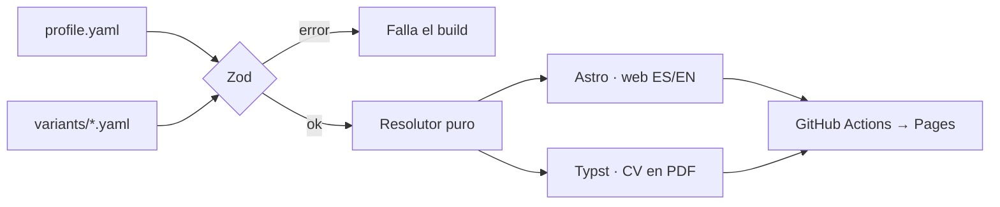

## Contexto

Mi CV no se edita en un procesador de texto: se **compila**. Este sitio y el CV en PDF salen de un único perfil maestro. El código es público en [github.com/Juanprm03/developer-cv](https://github.com/Juanprm03/developer-cv) y parte de la arquitectura de [inehosa1/cv](https://github.com/inehosa1/cv), reutilizada con autorización de su autor.

## Decisiones

- **Perfil maestro con identificadores estables**: experiencia, proyectos, habilidades y logros se referencian por id; las traducciones viven junto a cada hecho.
- **Variantes que solo seleccionan**: además del CV público, genera versiones internas para postulaciones que priorizan logros por etiquetas, sin poder añadir hechos.
- **Contexto de cada habilidad**: profesional, personal o formación. Las pruebas impiden presentar formación como experiencia laboral.
- **Typst para el PDF**: texto real en una columna, compatible con ATS, con control automático de páginas.
- **Motion accesible**: animaciones con CSS e IntersectionObserver que respetan `prefers-reduced-motion` y no ocultan contenido sin JavaScript.
