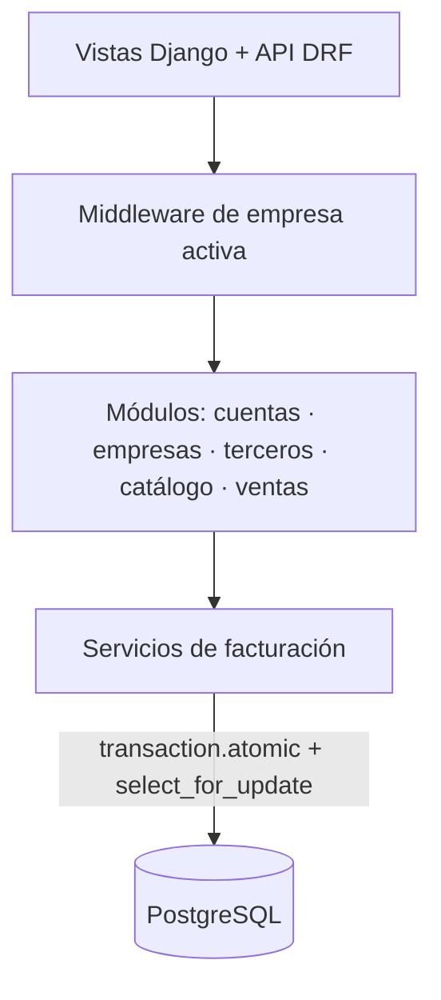

import Flow from '../../../components/mdx/Flow.astro';

## Problema

Las pequeñas empresas necesitan facturar sin errores de numeración ni mezcla de datos, aunque una misma persona trabaje con varias empresas. Este ERP es mi proyecto personal, **en desarrollo** (MVP); el código es público en [github.com/Juanprm03/nexo-erp](https://github.com/Juanprm03/nexo-erp).

## Solución

Un monolito modular en Django con vistas web y API REST que comparten la misma capa de servicios: cada operación sobre datos de varias tablas (numeración, totales, cambios de estado) vive en un único lugar.

## Flujo funcional

<Flow lang="es" title="Ciclo de una factura" steps={[{"title": "Empresa activa", "actor": "Usuario", "text": "El usuario elige con qué empresa trabaja; un middleware fija la empresa activa y sus permisos según su rol en ella."}, {"title": "Borrador", "actor": "Ventas", "text": "Se crea la factura en borrador para un cliente de la misma empresa."}, {"title": "Líneas y totales", "actor": "Servicio de facturación", "text": "Cada línea se añade con la factura bloqueada; subtotal, impuesto y total se recalculan con Decimal."}, {"title": "Emisión", "actor": "Servicio de facturación", "text": "En una transacción se bloquean la factura y la secuencia de la empresa, se valida que siga en borrador y tenga líneas, y se asigna el siguiente número."}, {"title": "Anulación", "actor": "Servicio de facturación", "text": "Solo una factura emitida puede anularse; las transiciones de estado no válidas se rechazan."}]} />

## Arquitectura conceptual

## Mi contribución

Proyecto personal: diseño, implementación y pruebas son míos.

## Stack

Python, Django y Django REST Framework · PostgreSQL · Docker · pytest y pytest-django.

## Retos técnicos

- **Numeración sin duplicados**: una fila de secuencia por empresa bloqueada con `select_for_update`, en lugar de calcular el máximo + 1; empresas distintas no compiten entre sí.
- **Emisiones concurrentes**: la propia factura también se bloquea, para que dos intentos simultáneos no pasen ambos la comprobación de borrador.
- **Aislamiento de datos**: productos y clientes deben pertenecer a la empresa de la factura.
- **Una sola fuente de reglas**: vistas, plantillas y API llaman a los mismos servicios, sin señales implícitas.

## Resultados verificables

- Pruebas automatizadas de modelos, servicios, cálculos, API, permisos, aislamiento de datos y concurrencia.
- Tesorería, auditoría transversal e inventario son trabajo futuro y no forman parte de la funcionalidad actual.
