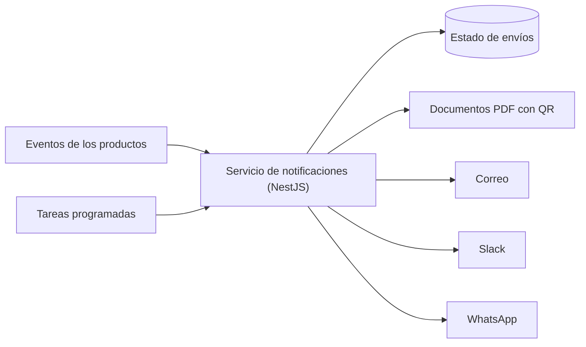

## Descripción general

Servicio centralizado que recibe eventos de los productos del ecosistema y los convierte en notificaciones por correo, Slack y WhatsApp, además de generar documentos como tickets PDF con código QR.

## Problema que resuelve

Evitar que cada producto implemente sus propios envíos y dar seguimiento al estado de cada notificación.

## Mi contribución y la del equipo

Fui uno de los principales contribuidores del servicio (**NestJS, TypeScript y Prisma**):

- Módulos de correo (con reintentos), Slack y WhatsApp, incluido un controlador de webhook con validación de la configuración.
- Seguimiento del estado de cada notificación con Prisma.
- Generación de tickets PDF con código QR y pruebas de integridad del QR.
- Reportes programados: correo diario de entregas con un Excel de varias hojas, que se omite si no hay datos, y alertas de ventas.
- Documentación de las APIs con Swagger / OpenAPI.

## Integraciones

WhatsApp Cloud API, Slack API, correo electrónico y los servicios de pagos y tickets que originan los eventos.

## Arquitectura

## Desafíos y soluciones

- **Entregas fiables**: reintentos en el envío de correo y registro del estado de cada notificación.
- **Documentos verificables**: pruebas que comprueban la integridad de los bytes del QR en el PDF.
- **Reportes útiles**: Excel con resumen, desglose y detalle, y omisión del envío en días sin datos.

## Estado

Funcionalidades descritas implementadas.
