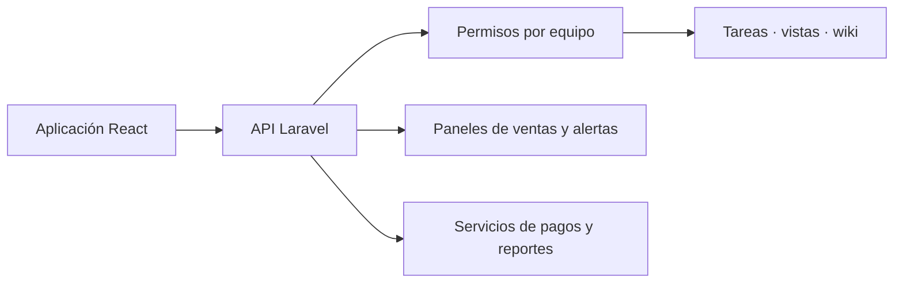

import Flow from '../../../components/mdx/Flow.astro';

## Problema

Los equipos necesitaban un lugar común para organizar su trabajo y seguir los indicadores de operación de los productos.

## Solución

Una aplicación interna con tablero de tareas, wiki, permisos por equipo y paneles de ventas conectados a los servicios del ecosistema.

## Flujo funcional

<Flow lang="es" title="Del acceso al seguimiento" steps={[{"title": "Acceso", "actor": "Miembro del equipo", "text": "Cada persona entra con los permisos de su equipo sobre tareas y wiki."}, {"title": "Organización", "actor": "Equipo", "text": "Las tareas se gestionan en vista de lista o Kanban, con propiedades, filtros y vistas guardadas."}, {"title": "Seguimiento de ventas", "actor": "Operación", "text": "Los paneles muestran las ventas y las alertas a partir de los servicios de pagos y ticketing del ecosistema."}, {"title": "Coordinación", "actor": "Operación", "text": "Las fechas bloqueadas se coordinan con el panel de tickets sin sobrescribir los cambios de otra aplicación."}]} />

## Arquitectura conceptual

## Mi contribución

- Base de seguridad para tareas y wiki.
- Tablero de tareas con propiedades, permisos por equipo, vistas guardadas y barra de filtros para lista y Kanban.
- Panel de ventas y alertas para el ecosistema de ticketing, y coordinación de fechas bloqueadas.
- Pruebas de funcionalidad con **PHPUnit**.

El equipo construyó la aplicación y sus demás módulos.

## Stack

Laravel y PHP · React, TypeScript y Vite · PHPUnit.

## Retos técnicos

- **Permisos por equipo** coherentes en tareas, vistas guardadas y wiki.
- **Cambios concurrentes** entre aplicaciones al compartir fechas bloqueadas.

## Resultados verificables

- Funcionalidades implementadas con pruebas de funcionalidad del tablero, permisos y vistas guardadas.
- **En desarrollo**: integración para conectar Claude con herramientas del sistema mediante Model Context Protocol (MCP).

{/* REVISAR: la integración MCP es declarada por el propietario; no se localizó su implementación en el código revisado. */}
