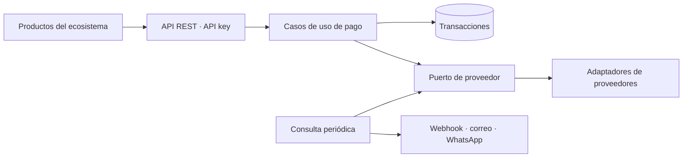

import Flow from '../../../components/mdx/Flow.astro';

## Problema

Varios productos necesitaban cobrar y entregar productos digitales sin que cada uno integrara por su cuenta a cada proveedor de pagos y de servicios, ni gestionara el estado de cada transacción.

## Solución

Un servicio central de pagos con APIs REST: cobra con tarjeta o enlaces de pago, paga servicios, entrega lo comprado y notifica el resultado al producto de origen y al usuario.

## Flujo funcional

<Flow lang="es" title="Ciclo de una transacción" steps={[{"title": "Solicitud", "actor": "Producto", "text": "Un producto del ecosistema solicita el pago a la API, autenticado con API key y con una clave de idempotencia."}, {"title": "Registro", "actor": "Servicio de pagos", "text": "La solicitud se valida y la transacción queda registrada como pendiente; la clave de idempotencia evita procesar dos veces el mismo cobro."}, {"title": "Cobro", "actor": "Pasarela", "text": "El cobro se realiza con tarjeta o mediante un enlace de pago, a través del adaptador del proveedor."}, {"title": "Consulta de estado", "actor": "Tarea programada", "text": "Una tarea programada consulta periódicamente las transacciones pendientes hasta conocer si fueron aprobadas o rechazadas."}, {"title": "Entrega", "actor": "Proveedor de servicios", "text": "Si el pago se aprueba, se entrega el producto con un número limitado de intentos; si falla, la transacción termina como fallida."}, {"title": "Notificación", "actor": "Producto y usuario", "text": "El resultado se envía por webhook al producto de origen, con reintentos acotados, y al usuario por correo o WhatsApp."}]} />

## Arquitectura conceptual

## Mi contribución

- Casos de uso, DTO y endpoints de **pago con tarjeta y enlaces de pago**, y su consulta de estado, con pruebas.
- **Claves de idempotencia** en el pago con tarjeta.
- **Servicio de cifrado RSA** para los datos que exige el proveedor, con pruebas.
- Casos de uso de **consulta y pago de facturas y seguros obligatorios**.
- Ajustes en los **adaptadores** y en la selección del proveedor durante la consulta de estado.
- **Webhooks de resultado** y notificaciones por correo y WhatsApp con manejo detallado de errores.

El equipo construyó la base del servicio (empresas, canales, órdenes, productos), la política de validación de solicitudes y precios, y otros adaptadores y módulos.

## Stack

NestJS y TypeScript · Prisma y MySQL · tareas programadas · Jest · Zod.

## Retos técnicos

- **Reintentos sin cobros duplicados**: idempotencia con bloqueo por empresa y clave.
- **Varios proveedores**: un puerto común y un adaptador por proveedor, sin acoplar los casos de uso.
- **Cobro y entrega separados**: pasos distintos del ciclo, cada uno con reintentos propios y registro de cada intento.
- **Webhooks fiables**: destinos validados contra una lista permitida, tiempo límite por intento y espera creciente.

## Resultados verificables

- Flujo de pago con tarjeta, enlaces, consulta de estado y notificación implementado en el código, con pruebas de los casos de uso y del cifrado.
- No se documentan conciliación, antifraude ni reembolsos: no forman parte de la evidencia revisada.
