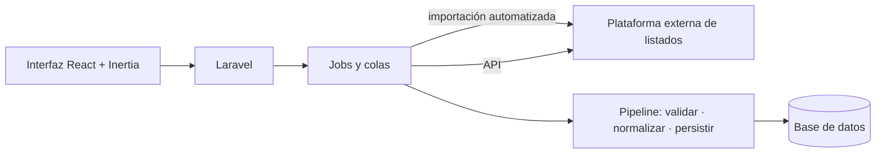

## Descripción general

Plataforma inmobiliaria del ecosistema: gestión y búsqueda de propiedades, importación y publicación en una plataforma externa de listados y automatización por WhatsApp.

## Problema que resuelve

Centralizar el inventario de propiedades de una inmobiliaria y mantenerlo sincronizado con una plataforma externa de listados sin carga manual.

## Mi contribución y la del equipo

Fui uno de los principales contribuidores del repositorio, con trabajo fullstack en **Laravel, React, Inertia y TypeScript**:

- Páginas de gestión, detalle y búsqueda de propiedades.
- Integración con la plataforma externa por dos vías diferenciadas: **importación automatizada** de listados y su **API** para consultar, crear y actualizar propiedades e imágenes.
- Pipeline de importación con validación, persistencia transaccional y procesamiento diferido de contactos e imágenes.
- Jobs, colas y comandos de sincronización, auditoría y mantenimiento de datos.

## Integraciones

Una plataforma externa de listados inmobiliarios (HTML y API) y WhatsApp a través del asistente de la plataforma conversacional.

## Arquitectura

## Desafíos y soluciones

- **Sesiones externas que expiran**: cliente HTTP con cookies, restauración de sesión y reautenticación ante expiración, con límites de solicitudes.
- **Datos heterogéneos**: parser que extrae precios, ubicación, características, contactos, imágenes y coordenadas, y valida el contenido mínimo.
- **Fallos parciales**: clasificación de errores recuperables y no recuperables, reintentos con espera y reporte de errores parciales al publicar.

## Estado

Implementado: importación por HTML y API, publicación y actualización remota. Archivar y eliminar siguen siendo operaciones locales.
