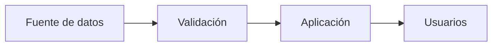

> **Placeholder.** Este caso de estudio es contenido de ejemplo y no describe ningún proyecto real.
> Sirve para verificar la colección MDX, el renderizado de Mermaid y las tarjetas de la landing.

## Contexto

[PLACEHOLDER] Problema de negocio y punto de partida.

## Decisiones

- [PLACEHOLDER] Decisión técnica y su motivo.

## Resultados

- [PLACEHOLDER] Resultado medible y verificable.
