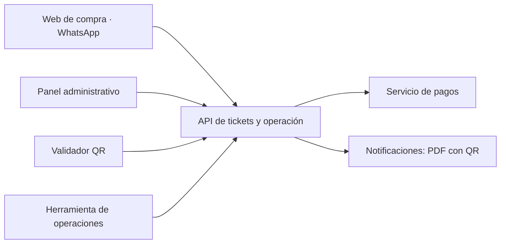

import Flow from '../../../components/mdx/Flow.astro';

## Problema

Un cliente del sector de entretenimiento necesitaba vender tickets digitales, entregarlos de forma fiable, validarlos en taquilla y dar a sus equipos herramientas para gestionar productos, fechas, usuarios y ventas. No bastaba con un bot de compra: hacía falta cubrir todo el ciclo.

## Solución

Un ecosistema de aplicaciones conectadas a una API central de tickets y operación: web de compra con acceso desde WhatsApp, entrega de tickets en PDF con QR, validador para taquilla, panel administrativo y reportes con alertas.

## Flujo funcional

<Flow lang="es" title="Del pedido al acceso" steps={[{"title": "Compra", "actor": "Visitante", "text": "El visitante elige su ticket en la web de compra o llega a ella desde un acceso por WhatsApp."}, {"title": "Pago", "actor": "Servicio de pagos", "text": "La compra se cobra a través del servicio de pagos del ecosistema."}, {"title": "Entrega", "actor": "Notificaciones", "text": "El ticket se entrega de forma segura como PDF con código QR por correo o WhatsApp."}, {"title": "Validación", "actor": "Taquilla", "text": "En el acceso, el validador comprueba el QR firmado y registra cada acción en una bitácora de auditoría."}, {"title": "Operación y reportes", "actor": "Administración", "text": "El panel gestiona productos, fechas bloqueadas y usuarios, y ofrece reportes de ventas y entregas con alertas."}]} />

## Arquitectura conceptual

## Mi contribución

| Componente | Mi contribución |
|---|---|
| API de tickets y operación | Desarrollé el módulo: tickets, operadores, productos, fechas bloqueadas, reportes, autenticación y modelo de lectura |
| Panel administrativo | Calendario de fechas, pasaportes y descuentos, reporte de entregas, dashboard exportable a Excel, manual de ayuda y endurecimiento del inicio de sesión |
| Validador QR | Bitácora de auditoría con retención, rechazo de QR sin firma, sesiones versionadas y baja efectiva de usuarios |
| Web de compra | Acceso a la compra por WhatsApp |
| Notificaciones y operaciones | Tickets PDF con QR, correo diario de entregas, alertas y dashboard de ventas |

El equipo construyó la base de la web de compra, del panel administrativo y del validador.

## Stack

Node.js y Express (API) · Next.js, React, TypeScript y Tailwind CSS (panel, validador y web) · MySQL · NestJS (notificaciones) · Vitest y Zod.

## Retos técnicos

- **Turnos largos en taquilla**: sesiones de duración suficiente con versionado, para que reactivar un usuario no recupere sesiones antiguas.
- **Seguridad en el acceso**: rechazo de QR sin firma y bitácora de las acciones de cada tableta.
- **Cambios concurrentes**: fechas bloqueadas compartidas entre aplicaciones sin sobrescribir los cambios de otra.
- **Resultados inciertos**: manejo seguro de operaciones de tickets con resultado incierto.

## Resultados verificables

- Funcionalidades implementadas y presentes en el código del ecosistema.
- Pruebas de permisos y de agregación de ventas en la API, y pruebas del validador.

Proyecto confidencial: no se publican el cliente, datos de ventas, usuarios ni infraestructura.
